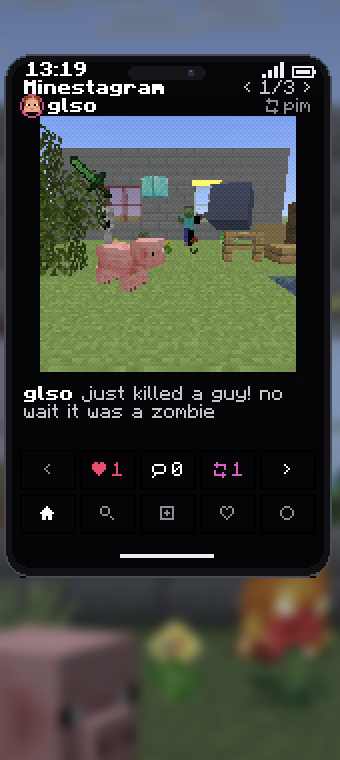
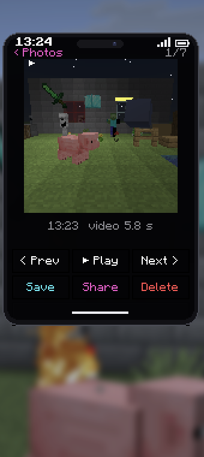
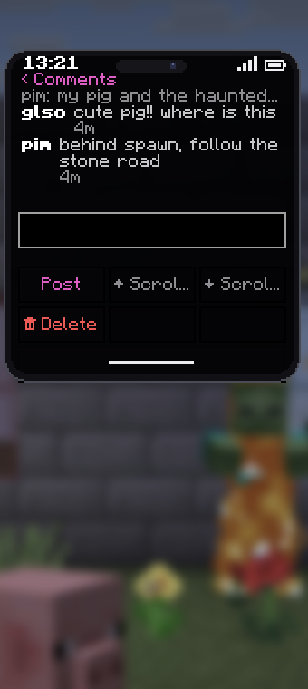
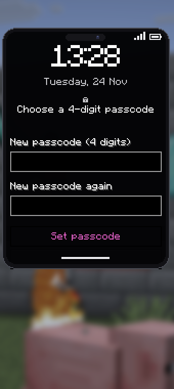
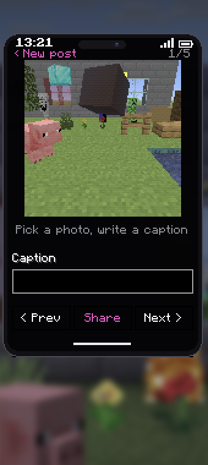
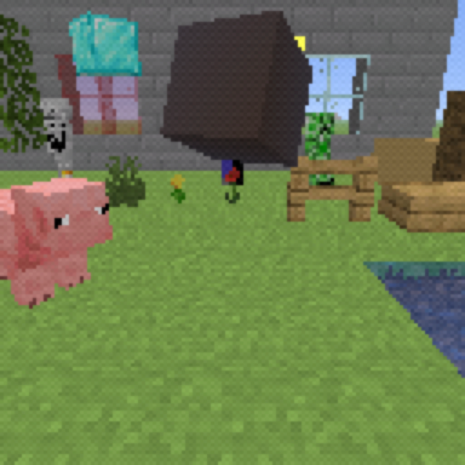
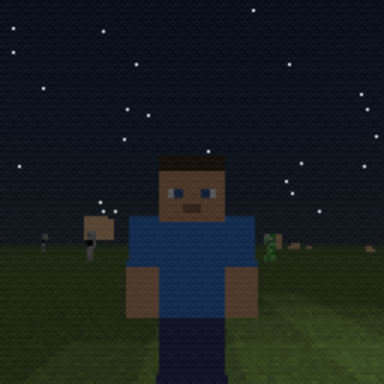

# Phone

A Paper plugin and resource pack that add a usable phone: right-click it to open a portrait phone screen made of
Paper dialogs. Lock screen with a passcode, a home screen with an app list, Messages (speech bubbles, contacts,
scrolling, editing and deleting, unread dot on the item), Camera (viewfinder, zoom, front camera, photos and short
videos), Photos (every picture you took or were sent, shown inside the phone, printed onto maps, shared),
Minestagram (accounts, posts, likes, comments, reposts, search, activity) and Settings.

- Minecraft Java 26.3, Paper 26.3 (`paper-api:26.3.build.253-stable`), Java 25
- Paper API and Adventure, nothing shaded. One class (`resourcepack/SamePortHttp`) reaches into the server's
  network listener by reflection so the pack can be downloaded through the Minecraft port; see Design decisions
- Pack format 97; post effects only, no vanilla core shader is overridden

| Home | Minestagram | Photos (video) | Comments |
| --- | --- | --- | --- |
|  |  |  |  |

| Lock screen | Messages | Conversation | New post |
| --- | --- | --- | --- |
|  |  |  |  |

| A photo (128x128, shown 4x) | Front camera |
| --- | --- |
|  |  |

## Changes in 1.3.0

- **Photos in messages.** Sharing a photo from the Photos app now puts the picture itself into the conversation (a 64 px
  thumbnail above a caption bubble), for both sides, and still puts a copy into the other player's Photos. The picture is kept
  in `plugins/Phone/attachments/<message id>.png` and goes away with the message; `messages.photo` column added to phone.db
  (upgrades itself).
- **Easier to read.** Brighter grey text (time, names, hints), pure white text in bubbles, a darker purple for your bubbles and a
  lighter grey for theirs (more contrast against the black screen), brighter accent / alert colours. Sizes and line spacing are
  fixed by the dialog (9 px lines), so this release only changes colour and contrast.
- **Minestagram scrolling.** Cause (found from the 26.3 client: a dialog is one scrollable layout, but every *new* dialog starts
  at the top again): a video post played by itself, sending a new dialog for every frame, so the scroll position jumped back to
  the top ten times a second. Videos now wait on their first frame; `minestagram.autoplay: false` is the new default (the key
  was renamed from `autoplay-videos`, so an old `true` on a server does not carry over).
- **Pause / Play.** Videos in Photos and Minestagram have a Pause button that holds the frame (the dialog is not re-sent while
  paused, so scrolling works) and a Play button that carries on from there. In the feed a video post has the button in the middle
  of the first row; the repost / delete button moves to the second row, in place of "new post".
- **Camera filters.** The **Q** key (drop) cycles none, Mono, Noir, Sepia, Vivid, Warm, Cool, Fade, Vignette and Pixel. The
  viewfinder previews it with a post effect (`phone:filter_<name>`, needs the pack), and the saved photo or video has the same
  filter applied to every frame (`camera/Filters.java`; the post effects are generated from the same table, keep them in sync).
  `camera.filters: false` turns it off; `/phone shutter <player> filter <n>` sets it from a script. The filter is remembered until
  the server restarts. A player without the pack still gets the filter in the saved picture.
- **Printed videos pause too.** Right-click with a printed video map in the main hand to pause / play it (one state per map, for
  everyone who sees it; item frames are left alone). Not tried on a client.
- lang/en.yml is version 4 (the old file is kept as en.yml.old-3).

## Changes in 1.2.0

- **New look.** The phone is portrait now: a black screen in a rounded bezel with the dynamic island, status bar
  (time, signal, battery), white text, pink accents and the home indicator at the bottom (it is a button: Home).
  The dialog's buttons are part of the screen: every row of buttons paints its own piece of the phone (see "The
  screens"). Home is an app list.
- **Photos app.** Every photo and video you take is kept in Photos (up to `photos.max-per-player`, default 100)
  until you delete it, shown inside the phone, 128x128, pixel for pixel. Prev / Next, Print (a photo map, as
  before; a video map for videos), Share (post to Minestagram or send a copy to a contact: it lands in their Photos
  with a message) and Delete (press twice). Videos play inside the phone with Play. The old "Photo taken" screen
  is gone: after the shutter the Photos app opens on the new picture; Back returns to the viewfinder.
- **Minestagram.** Accounts (handle and bio, created the first time you open it), posts of a photo or video from
  Photos with a caption, a feed with paging, likes, comments (delete your own; post authors and moderators may
  delete any on their post), reposts, account search, an activity list of what happened to your posts, profile
  pages (tap the profile tab on your own to edit it). Video posts play once when they come up. Rate limits, mutes
  (`/phone mute` mutes Minestagram too), lengths and a post cooldown are in `config.yml`. Permissions `phone.gram`
  and `phone.gram.moderate`. Pictures of posts are copies, so deleting a photo does not break a post.
- **Photos look like the game.** With the client assets (the 26.3 client jar, downloaded once from Mojang into
  `plugins/Phone/cache/`) photos show real block textures and block shapes (stairs, slabs, fences, flowers,
  leaves, glass, stained glass, water, lava, rotated model elements), tinted grass, leaves and water by biome;
  players with their second skin layer, arm swings and what they hold; zombies, skeletons, creepers, pigs, cows and
  sheep with their textures; block, item and text displays with their transformation and billboard; heads worn by
  armour stands at their head pose. So ragdolls and props built from display entities or armour stands show up.
  Custom item models (RP Engine and the like) need their resource pack listed in `camera.textures.extra-packs`.
- `/phone open <player> photos|gram`, `/phone click <player> <path>` (runs a button, for command blocks and
  testing), `/phone gram delete <post id>`.
- Fixed: the lock-screen clock's "2" was blank (its digits are now the pack's own).
- The language file is version 3 (an older `en.yml` is kept as `en.yml.old-2`).

## If the phone shows plain dialogs and the camera has no frame

That is what the phone looks like for a player whose client has **not reported this plugin's pack as loaded**:
plain text screens, no player heads, no bubbles, no viewfinder or zoom effect. Version 1.0.0 served the pack on a
port of its own (8765), which most hosts do not open, so on such a server nobody ever got the pack. Since 1.1.0:

- the pack is downloaded through the Minecraft port itself (`resource-pack.mode: auto`); a 1.0.0 `config.yml`
  with `mode: builtin` is switched to `auto` once, automatically
- a player whose download fails or who declines is told so in chat, and the console says why
- `/phone ui` shows what the server knows about your pack; `/phone ui fancy` forces the textured phone for a player
  who installed the pack by hand; `assume-loaded: true` does that for everyone (merged server packs)
- behind a Velocity/Bungee proxy the Minecraft port cannot serve files: use `mode: builtin` with an open port, or `url`

## What was checked, and what was not

**1.3.0 (real 26.3 client, GUI scale 3, buttons driven with `/phone click`):** a photo sent in a message shows as a thumbnail
above its caption bubble in the conversation; the new bubble colours; a video post in the feed waits on its first frame with a
Play button, and after Play + Pause it stops on a later frame with the Play button back; the camera viewfinder with the Sepia and
Pixel filters (post effects) and the filter name in the action bar. **Not checked:** a real mouse-wheel scroll in Minestagram
(the rig cannot send input; the cause was found in the client code and the config, not seen), pressing Q, the saved photo with a
filter looked at (only the maths is unit-tested), the other filters on screen, pausing in the Photos app, a photo message
received by a second player, Minestagram posts with the pause button in the 5-column row on a real click.

Earlier checks (1.2.0):

Checked on a real 26.3 client against a Paper 26.3 server, 1.2.0 (screenshots above come from those runs):

- the portrait phone on every screen: lock (set-up), home, contacts, conversation, Photos with a photo and with a
  video, video playback inside the phone (frames changing), Minestagram account set-up, feed (own and other
  people's posts, a repost, likes, the tab bar), profile, comments, new post, search, activity; the plain-text
  feed for a player without the pack
- the row backgrounds line up with the vanilla buttons, the hover border shows, the home-indicator row closes the
  phone (GUI scale 2 and 3)
- the client jar download (SHA-1 checked) and textured photos: blocks and models listed above, stained glass, water,
  leaves, flowers, fences, slabs, stairs, a chest (map colour), a zombie, skeleton, creeper, pig, a block display, an
  item display, a text display, a player head on an invisible armour stand, the photographer as a selfie
- six unit tests: the photo text (every pixel once, the cursor returns), handles, model resolution

Screens were reached with `/phone open` and `/phone click`, which run the same code as the buttons.

**Not checked** (the test client could not be given mouse or keyboard input, and there was only one client):

- clicking or typing in the dialogs at all: passcode entry, sending, captions, comments, handles, search text
- two players: likes, comments and reposts from someone else, the activity hint, sharing a photo to someone
- downloaded skins (the test server is offline-mode: stand-in skin), the second skin layer on a real skin
- cows, sheep, held items and the arm swing in a photo; text display letters (they were too small to read at that
  distance); extra packs; custom item models
- how big the dialog packet of a photo is on a slow connection; many players browsing videos at once
- everything in the 1.1 list below that is still unchecked: sounds, wheel zoom, F, item frames, the recipe ...

Still from 1.1 and not re-checked in 1.2: the pack through the Minecraft port, the unread dot on the item, zoom post
effects, printing to a map and the map surviving a restart.

## Setup

1. `./gradlew build` (needs a JDK 25 or newer). Output: `build/libs/phone-1.3.0.jar` and `build/pack/phone-pack.zip`
   with its SHA-1 in `build/pack/phone-pack.zip.sha1`.
2. Put the jar in `plugins/` (delete the old Phone jar) and start the server. `plugins/Phone/` gets `config.yml`,
   `lang/en.yml`, `phone.db`, `photos/` (printed photos), `videos/`, `gallery/` (the Photos app), `minestagram/`
   (pictures of posts), `cache/` (the client jar for textured photos) and `phone-pack.zip`.
3. Choose how players get the pack (next section), then `/phone give <player>`.

Only when you change the pack's art or geometry: `python3 tools/gen_pack.py` regenerates textures, the `phone:ui`
font, the zoom post effects, the sounds (needs `ffmpeg`) and `src/main/resources/font/glyphs.properties`.
`python3 tools/gen_widths.py <client.jar>` rebuilds the default-font width table from a vanilla client jar.
`python3 tools/validate_shaders.py <glslang> resourcepack/assets resourcepack/assets/phone/shaders/post/*.fsh`
compiles the shaders the way the 26.3 client does (SPIR-V).

## Resource pack hosting

`resource-pack.mode` in `config.yml`:

| mode | what happens |
| --- | --- |
| `auto` (default) | `same-port`; if the Minecraft port cannot be hooked, `builtin`. |
| `same-port` | The client downloads the pack from the Minecraft port. Nothing else to open. Not behind a proxy. |
| `builtin` | The plugin serves `phone-pack.zip` over HTTP on `builtin.port` (8765). Open that TCP port. |
| `url` | You upload `plugins/Phone/phone-pack.zip` to a host that serves the file directly and put the link in `resource-pack.url`. The plugin sends that link with the SHA-1 of its own copy, so upload the file again after every plugin update. |
| `none` | Nothing is sent. Use this when you merge `resourcepack/` into your server pack, and set `assume-loaded: true`. |

The link sent to a player uses the address they typed to join, or `builtin.public-host` if set. The pack is sent
on join with the Paper/Adventure resource pack API, `replace(false)`, so other packs stay. `required` and `prompt`
are configurable. `/phone pack` (or Settings on the phone) sends it again.

### Changing textures

`plugins/Phone/textures/` takes `phone.png`, `phone_unread.png`, `photo.png` and `photo_paper.png` (square PNGs;
the built-in ones are in `textures/default/` as a starting point). With only `phone.png` the red dot is drawn onto
it for the unread look. Anything else in the pack (app icons, bubbles, sounds, shaders) is replaced by a file with
the same path under `plugins/Phone/pack/`. `/phone reload` rebuilds the pack and sends it to everyone online. If
the phone's model lives in another pack, point `item.models` in `config.yml` at it.

Without the pack the phone still works: screens are plain text, sounds fall back to vanilla ones, zoom uses the
FOV method. One thing does not degrade by itself: the item's look is an `item_model` component, which is the same
for everyone, so players without the pack see the missing-model cube. If many of your players play without the
pack, set `item.use-item-model: false` (the phone then looks like its base item and unread shows as a glint).

## Commands and permissions

| command | permission | |
| --- | --- | --- |
| `/phone` | `phone.use` | open your phone (you must carry one) |
| `/phone give [player] [phone\|paper [amount]]` | `phone.give` | give a phone or photo paper |
| `/phone block <name>`, `/phone unblock <name>` | `phone.message` | your own block list (also a button in every conversation) |
| `/phone fov <30-110\|reset>` | `phone.camera` | tell the camera your FOV setting so photos match your screen |
| `/phone pack` | `phone.use` | send the resource pack again |
| `/phone ui [auto\|fancy\|plain]` | `phone.use` | show or choose textured / plain-text screens |
| `/phone open <player> [home\|messages\|camera\|photos\|gram\|chat <name>]` | `phone.admin` | open a screen for a player, skipping their passcode |
| `/phone click <player> <path>` | `phone.admin` | run a button (`photos/0`, `gramf/1`, `gramcom/0` ...) as if the player clicked it |
| `/phone gram delete <post id>` | `phone.gram.moderate` | delete a Minestagram post |
| `/phone shutter <player> [print\|video\|selfie\|save]` | `phone.admin` | work the camera of a player in the viewfinder |
| `/phone passcode reset <name>` | `phone.admin` | remove a forgotten passcode |
| `/phone status` | `phone.admin` | pack delivery, SHA-1, video frames in memory |
| `/phone mute <name> [minutes]`, `/phone unmute <name>` | `phone.admin` | stop a player from sending |
| `/phone reload` | `phone.admin` | reload config and language |

`phone.use`, `phone.message`, `phone.camera`, `phone.gram` default to everyone; `phone.give`, `phone.gram.moderate`
(delete any post or comment, no post cooldown) and `phone.admin` to operators.

## How it works

### The item

A phone is any item with the `phone:phone` tag in its persistent data. Its look is the `item_model` component
pointing at one of three item model definitions in the pack: `phone:phone`, `phone:phone_unread` (red pixel dot,
top right) and `phone:phone_camera` (a `select` on `display_context` that draws nothing in first person, so the
phone does not cover the viewfinder). The plugin sets the state on every phone the player carries when a message
arrives, when the last unread message is read, on join, on pickup, and in a slow pass every two seconds. Messages
belong to the player's UUID: a stolen phone shows the thief's messages; a dropped phone loses its dot.

### Lock screen and passcode

With `passcode.enabled` (default) a player chooses a 4-digit passcode the first time they open a phone and enters
it every time after that; the apps appear after signing in. The phone locks again when its screen closes. Five
wrong codes lock it for 30 seconds (both configurable). The code is changed in Settings and belongs to the player,
like the messages: it is stored as a salted SHA-256 hash, which keeps it out of plain sight but, with only 10 000
possible codes, would not stop someone who has the database file.

The code is typed into a dialog text field. Dialogs have no password field, so the digits are visible while typed.

### The screens

Every screen is one multi-action dialog whose body is a single multi-line text. With the pack, each line is built
by `ui/Line`: glyphs of the `phone:ui` font (bitmap providers plus a `space` provider with advances of ±1 … ±512)
are placed at absolute pixel positions, background first, text last. A speech bubble row is a left cap, tiles of
128/64/…/1 px that add up to the text width, and a right cap; the pieces are white and take the bubble colour from
the text colour. The phone behind the text (bezel, island, status bar, black screen) is one tall glyph on the first
line; a screen taller than one glyph continues it on line 24.

**Buttons are part of the screen.** The 26.3 client lays dialog buttons out in a grid with 2 px between columns and
rows, centred under the text, and draws a button's label without clipping it. Every grid here is exactly 148 px wide
(1, 2, 3 or 5 columns: 148, 73, 48, 28 px buttons), so it lines up with the screen. The label of the first button of
each row starts with a "band" glyph: the bezel and black screen for the whole row and the 2 px under it, with a
1 px hole where that button's own border is, so the border still lights up on hover. The other buttons of the row
cover their grey face with a "cover" glyph. The client cuts the dialog off at the bottom of its last button, so the
phone's rounded bottom with the home indicator is the label of the last row, a single button that goes Home.
Rows are filled up with blank buttons. The vanilla title and the exit button (Back / Close, also Escape) stay.

**Photos in the phone.** The `phone:photo` font has one glyph per photo row: a white 1x1 pixel that row r draws r px
below the top of its text line (a negative ascent; the client only rejects an ascent above the glyph's height, so the
top rows get a taller cell). A whole picture therefore hangs from one text line, and each pixel takes its colour from
the text colour. A bitmap glyph advances by its width + 1 = 2 px, so every row is drawn in two passes, even columns,
then odd. Neighbours of the same colour share one text component: a photo is about 16 000 small components, a few
hundred kilobytes in the dialog packet before compression. A video plays by sending the screen again for every
frame (`photos.playback-fps`).

Text is measured on the server with `font/default_widths.tsv` (2 400 characters, generated from the vanilla jar):
ASCII, Latin-1 including ä ö å, Greek, Cyrillic. Bold is exact (+1 px per character). Characters outside the table
(CJK, emoji) are drawn by the client's unifont fallback and are measured at 9 px, so their bubbles can be a few
pixels too wide. Private-use characters and `§` codes are stripped from typed text.

Buttons are custom click actions `phone:<path>`; the client returns them with the input values and
`UiController.onClick` routes them. Nothing is stored per dialog.

### Post effects

All three are added and removed per player with `Player.postEffects()`.

| effect | shader | what it does | when |
| --- | --- | --- | --- |
| `phone:screen` | `post/screen.fsh` | cool tint and vignette over the world behind the dialog | while a phone screen is open |
| `phone:camera_<zoom>` | `post/camera.fsh` | magnifies the centre of the frame, dims everything outside the photo square, draws brackets, thirds and zoom pips | while the viewfinder is open; one JSON per zoom level |
| `phone:flash` | `post/screen.fsh` | white flash | 3 ticks after the shutter |

Post effects run on the 3D frame before the HUD, so they cannot draw into the dialog or over the hotbar.

### Zoom

Wheel up or down in the viewfinder changes the zoom level (the slot change is cancelled, the phone stays in hand).

- **Primary: post effect.** Robust and server-driven through a first-class API; no entity or HUD trick is needed
  to trigger it. Cost: it is a digital zoom, so the picture gets blurry at 8x and above, and the vanilla
  crosshair is not zoomed.
- **Fallback: FOV.** A movement-speed modifier makes the client narrow its own FOV. It tops out near 2x, roots
  the player, and does nothing if the client has "FOV Effects" at 0. Used when `camera.zoom-method: fov`, and
  automatically for players without the pack.

The photo is rendered with the zoom the method actually gives, so it matches the frame.

In a conversation, Scroll up / Scroll down move the window by `ui.scroll-step` messages; a window holds as many
messages as fit `ui.max-lines-per-page`. Edit lists your latest messages to that person; picking one opens it in a
text field with Save and Delete. An edited message is marked "edited"; a deleted one is gone for both sides. Both
can be switched off or limited to recent messages (`messaging.allow-edit`, `allow-delete`, `edit-window-minutes`),
and edits fire `PhoneMessageEvent` with `isEdit()`.

### Photos

A server cannot see a client's screen, so the photo is rendered on the server. On the shutter:

1. Main thread, same tick: the eye position and direction, world time and weather, and everything visible besides
   blocks: players and simple mobs as posed, textured models; display entities, held items and worn heads as models
   with their transformation; other creatures as boxes (at most 64 creatures and 384 props).
2. Main thread, next ticks: the chunks the view can reach are copied as `ChunkSnapshot`s (with biomes),
   `chunks-per-tick` (6) at a time, at most `max-chunks` (120). Unloaded chunks are skipped, never loaded.
3. One background thread: 128×128 rays walk the snapshots voxel by voxel up to `max-distance` (96).
4. Main thread: the picture is saved to the player's Photos and the Photos app opens on it.

**With the client assets** (`camera.textures`, on by default): every block is drawn with its real block-state model:
the ray is tested against the model's boxes (rotated elements too) and the face it enters picks the texel of the
real texture, tinted like vanilla (grass, foliage and water from the colour maps and the biome's temperature; rain
comes from a table of biome families). Transparent texels let the ray through (leaves, flowers, panes); partly
transparent ones (stained glass, ice, water) are blended front to back, and water deepens towards blue. Faces get
vanilla's directional shading and the stored sky/block light next to them. Far away one photo pixel covers many
texels, so surfaces fade into their texture's mean colour instead of turning to noise. Blocks the client draws in
code (chests, signs, beds, banners) keep their map colour.

The assets are the 26.3 client jar, downloaded once from Mojang (`piston-meta` → `client.jar`, SHA-1 checked) into
`plugins/Phone/cache/` and only read; it is never sent to anyone. `camera.textures.extra-packs` lists resource
packs (zip or folder) searched first, for custom item models and retextures. Without the jar (no internet,
`download: false`) photos use block map colours and full cubes, as in 1.1.

**Players** are the vanilla player model with the second skin layer (transparent pixels let the ray through), skins
downloaded once per player from the address in their profile, posed from what the server knows: where they look,
sneaking, swimming, gliding, sleeping, sitting in a vehicle, an item held up, an arm swing under way, and a walk cycle
while they move; the items in both hands are drawn at the hands. **Zombies, husks, drowned, skeletons, strays,
wither skeletons, bogged, creepers, pigs, cows and sheep** are built the same way from their textures.
**Display entities** use their block state, item model or text, their transformation, yaw/pitch and billboard;
**armour stands** show the item on their head at the head pose (player heads with the skin of their profile).

Cost: the main thread only pays for the snapshot copies and the entity list. The render is a few million box tests in
the worst case and is queued on one thread, so several photographers share one core. A cooldown (5 s) applies per
player.

Print makes a **filled map**: it shows in hand and in item frames with no client support, and a custom item could
not show a picture at all. The image is saved as `plugins/Phone/photos/<map id>.png` and indexed in `phone.db`;
when the server loads the map again the plugin repaints it from the file. Name and lore carry photographer, date
and (optionally) location. `require-photo-paper` consumes a Photo Paper item outside creative mode; a full
inventory drops the photo at your feet or refuses, per config. The picture stays in Photos.

Left-click in the viewfinder switches to the **front camera**: the picture is taken from arm's length in front of
your face, looking back at you. The viewfinder keeps showing the rear view (the client decides what is on screen;
press F5 to see roughly what the front camera sees).

### Photos app and Minestagram

Photos keeps rows in the `gallery` table and pictures in `plugins/Phone/gallery/<id>.png|.bin` (the video format of
printed videos). A full library refuses new pictures with a chat message. Sharing to a contact sends them a message
and puts a copy in their Photos (unless theirs is full).

Minestagram stores accounts, posts, likes, comments and reposts in `phone.db` (`gram_*` tables); the picture of a
post is a copy in `plugins/Phone/minestagram/<post id>`, so it outlives the photo in Photos. A repost is a row of
its own that points at the original; likes and comments always belong to the original. Deleting a post deletes its
likes, comments and reposts. Authors who are online hear the notification sound and get a hint when someone likes,
comments on or reposts their post (`minestagram.notify`).

### Video

The swap-hands key (F) starts and stops a recording, up to `camera.video.max-seconds` (6) at `fps` (4). The chunks
within `max-distance` (48) are copied once; after that each frame only notes the camera and everything alive, and
is rendered on the background thread. So blocks stand still in a video and players and mobs move.

A saved video is a map like a photo. It plays in a loop while someone holds it (or has it in an item frame in
view). Its frames live in `plugins/Phone/videos/<map id>.bin` and are in memory only while it is being watched:
five seconds after the last look they are dropped, and a video lying in an inventory never loads them.
`/phone status` shows how many frames are in memory.

### Messages

SQLite (`plugins/Phone/phone.db`) on one background thread; every Bukkit call happens on the main thread. A
message to an offline player simply waits unread and is announced when they join. `PhoneMessageEvent` (cancellable,
text editable) fires before a message is stored. Moderation: per-player block list, admin mute, rate limit,
maximum length.

## Known limitations

- **Dialogs cannot be updated in place.** Showing a new message means sending the whole dialog again, which empties
  the text field. Every button on the conversation screen hands the typed text back and it is restored; a refresh
  the player did not ask for cannot. `messaging.auto-refresh: false` turns those off (sound only, press Refresh).
- **The server is not told when a dialog closes**, except that Escape runs the exit action. So every screen has one
  and Escape goes back one screen at a time.
- **The client clips the dialog body at the last button.** The phone panel therefore ends flat under the buttons
  instead of with its rounded bottom edge, and on a small window a long conversation scrolls inside the dialog.
- The dialog title row and its warning icon are vanilla and cannot be removed.
- Buttons are vanilla widgets. App icons are drawn over them; the other buttons (Send, Scroll, Back ...) keep the
  vanilla look, because a pack can only retexture every button in the game at once.
- What the server does not know about a player is not in the picture: the exact step of the walk cycle and how the
  client animates an item in use.
- A video is 128x128 at a few frames per second, blocks do not change in it, and it has no sound.
- The viewfinder cannot show the front camera's view.
- The FOV of the client is unknown to the server: photos assume 70 until the player runs `/phone fov`.
- Photos are renders, not screenshots: no particles, no clouds, no item frames, no armour, no capes, no entity
  shadows; blocks the client draws in code (chests, signs, beds, banners, shulker boxes) are map-colour cubes;
  mobs other than the ones listed are boxes; text displays use the ASCII part of the font only.
- A photo in a dialog is a big packet (a few hundred kilobytes before compression); a playing video sends one per
  frame. Lower `photos.playback-fps` or `minestagram.autoplay: false` (the default) on a busy server.
- The client's dialog layout puts all buttons under the text: the like / comment / repost row sits under the
  caption, not right under the picture as in the real app.
- Zoom pips show the position among the pack's eight levels, not among the levels chosen in config.
- Every printed photo uses one map id; ids are a finite, world-wide resource.
- Player heads of offline players depend on the client being able to resolve the profile.
- If two packs override the same vanilla file only one wins; this pack overrides none.

## Design decisions and trade-offs

- **Post effects instead of core shaders.** The request allowed either. On 26.3 one core shader that fails to
  compile makes the client drop every server pack, and two packs cannot both override `core/text`. Post effects
  have their own ids, cannot collide, and have a server API.
- **One multi-line text per screen** rather than one body element per bubble: elements are spaced 10 px apart by
  the client, lines of one text are exactly 9 px apart, so bubble rows can tile.
- **Lines padded to the panel's width.** The dialog text widget counts lines by wrapping at the width of its
  widest finished line, measured from the line start; if the cursor ever travels past that, it reserves empty
  lines. Found on the client, documented in `ui/Line`.
- **Key-based click actions** instead of callbacks: no per-dialog state on the server, nothing expires.
- **Hierarchical Escape** (back, then close) because it is the only close signal there is.
- **Filled maps for photos**: the only vanilla item that can show an arbitrary image.
- **SQLite over JSON**: conversations are read by pair, by page and by unread state, and written while people play.
- **The pack comes through the Minecraft port.** 1.0.0 avoided this because it needs the server's Netty listener,
  which is not Paper API; in practice a second open port is exactly what game hosts do not give you, and a phone
  without its pack is not the product. The hook is one class, found by reflection on field types, passes on
  every request that is not its own, and falls back to the separate port when it cannot be installed.
- **Passcode in a text field, not a keypad of buttons.** Every button press replaces the whole dialog; a keypad
  would redraw the screen four times per sign-in.
- **Videos reuse the photo renderer over frozen chunks.** Copying chunks every frame would put the cost on the
  main thread; freezing them keeps a recording as cheap per tick as standing still.

## Layout

```
src/main/java/fi/alavesa/phone/
  PhonePlugin            wiring, reload, recipe
  phone/                 PhoneItems, PhoneListener (use, item state), PhoneCommand
  ui/                    UiController (screens, routing, button grids), ScreenRenderer + Fancy/PlainRenderer, Line,
                         Glyphs, PhotoText (a picture as text), FontWidths, TextWrapper, Views
  messaging/             MessageService, PhoneMessageEvent, RateLimiter, records
  camera/                CameraService (viewfinder, zoom, photo, video), SceneCapture (entities -> scene), RayTracer,
                         Scene, Figure (players and mobs), Prop (models with a transform), SkinCache, PhotoStore (maps)
  camera/assets/         AssetSource (client jar download, extra packs), Models (block states, models, items),
                         Texture, Tints (colour maps)
  media/                 MediaStore (picture files + cache), Gallery (the Photos app)
  social/                Gram (Minestagram rules)
  storage/               Database, PlayerSettings (FOV, UI mode, passcode)
  resourcepack/          PackService (build, deliver, who has it), SamePortHttp, PackHttpServer
  config/                PhoneConfig, Lang
  util/                  PostFx, Sounds, Tasks
resourcepack/
  pack.mcmeta
  assets/phone/items/         phone, phone_unread, phone_camera, photo, photo_paper
  assets/phone/models/item/   phone, phone_unread, photo, photo_paper
  assets/phone/textures/item/ the four 32x32 textures
  assets/phone/font/ui.json   bubbles, panels, row bands, covers, app icons, marks, ring, clock digits, spaces
  assets/phone/font/photo.json one 1x1 pixel per photo row (see "Photos in the phone")
  assets/phone/textures/font/ bubble_*, panel_<h>/panelx_<h> (14 each), bands, band_home, covers, icons, marks, ...
  assets/phone/post_effect/   screen, flash, camera_{1,2,3,4,6,8,12,16}
  assets/phone/shaders/post/  screen.fsh, camera.fsh
  assets/phone/sounds.json, sounds/phone/{notify,send,shutter}.ogg, lang/en_us.json
tools/                   gen_pack.py, gen_widths.py, pnglib.py, validate_shaders.py
```

The sounds are synthesised placeholders; replace the `.ogg` files with your own under the same names.

## Testing checklist

Two players, A and B, both with a phone.

- [ ] 1.2: Home shows the app list; Photos, Minestagram open; the phone's bottom edge closes under the last row
- [ ] Take a photo: Photos opens on it; Back returns to the viewfinder; Prev/Next, Print (map), Delete (twice)
- [ ] Record a video: it is in Photos; Play plays it in the phone; Save makes a video map
- [ ] Share → Post to Minestagram: caption, Share; the post is first in the feed; Share → B: B gets a message and the copy in Photos
- [ ] Minestagram first open: account set-up; a taken handle and "ab" are refused
- [ ] B likes, comments on and reposts A's post: A hears it and sees it in Activity; counts change; A deletes B's comment
- [ ] Delete your own post (press the bin twice); a moderator deletes someone else's with /phone gram delete
- [ ] Search finds accounts; tapping one opens their profile; the profile tab on your own profile edits it
- [ ] A photo of a varied scene: textures, plants, glass, water, mobs, display entities, a ragdoll, someone holding a sword

- [ ] Pack prompt appears on join; after accepting, the phone item shows its texture
- [ ] `/phone ui` says "textured"; if not, the console says why the pack did not load
- [ ] First right-click asks for a new passcode (rejects 3 digits, letters, two different codes), then shows Home
- [ ] Close and open again: lock screen with the time; wrong code counts down, the fifth locks for 30 s; right code opens
- [ ] Settings: change passcode (wrong old code refused); `/phone passcode reset` makes the phone ask for a new one
- [ ] Home: three round icons, hover lights the label's border, the Messages badge shows the unread count
- [ ] Right-click (air, block, entity; main and off hand) opens the phone and does nothing else
- [ ] Messages → B → type → Send: bubble appears on the right, A hears the send sound
- [ ] B hears the notification, sees the hint, B's phone gets the red dot wherever it is in the inventory
- [ ] B opens the conversation: dot and badge disappear; A's next refresh shows the double tick
- [ ] Both in the conversation: an incoming message redraws the screen about a second later
- [ ] Type without sending, press Refresh / Older / Block: the text is still in the field
- [ ] A long message wraps inside its bubble; ä ö å align; an emoji does not break the layout
- [ ] A long history: Scroll up / Scroll down move three messages at a time, typed text survives
- [ ] Edit: pick a message, change it, Save: both sides see the new text marked "edited"
- [ ] Edit: Delete removes it for both sides; an unread deleted message also clears the other side's dot
- [ ] Message B while B is offline: B gets the dot and the hint on join; survives a server restart
- [ ] Search finds an offline player by exact name; Block stops their messages; `/phone mute` and the rate limit refuse with a notice
- [ ] Escape goes Conversation → Contacts → Home → closed, and the blue tint goes away
- [ ] Decline the pack: all screens readable as plain text, vanilla sounds
- [ ] Camera: frame appears, phone hidden in first person, wheel zooms, sneak closes, cooldown message
- [ ] Left-click: "Selfie" in the action bar; the photo shows you with your skin, facing the camera
- [ ] Photograph another player standing, walking, sneaking, swimming, in a boat, in a bed, with elytra
- [ ] F starts a video, F stops it (or it stops by itself); Save video; hold it: it plays; a walking player moves in it
- [ ] `/phone status` shows frames while the video is held and 0 a few seconds after it is put away
- [ ] `plugins/Phone/textures/phone.png` + `/phone reload`: everyone gets the new phone look
- [ ] The photo shows what was inside the square, at every zoom level
- [ ] Print: item has name and lore; shows in hand and in an item frame; still there after a restart
- [ ] Full inventory when printing; `require-photo-paper` in survival and in creative
- [ ] Drop the phone with a dialog or the viewfinder open; hold two phones; give your phone to someone else
- [ ] `/phone reload` with a screen open; `/reload`-free restart keeps mutes, blocks and unread counts
