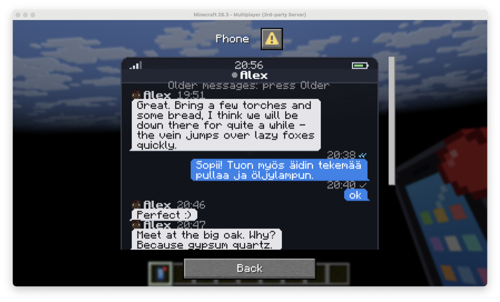
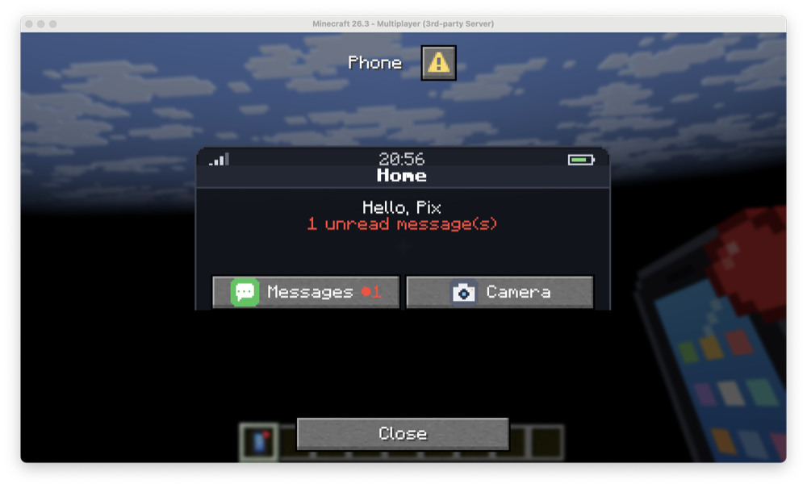
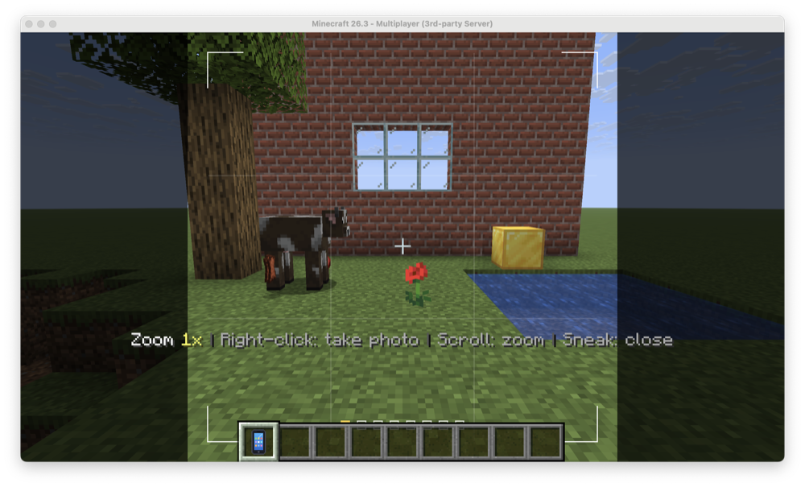

# Phone

A Paper plugin and resource pack that add a usable phone: right-click it to open a phone screen made of Paper
dialogs, with a Messages app (speech bubbles, contacts, unread dot on the item) and a Camera app (viewfinder, zoom,
printed photos).

- Minecraft Java 26.3, Paper 26.3 (`paper-api:26.3.build.253-stable`), Java 25
- Paper API and Adventure only: no NMS, no packet library, no shaded dependencies
- Pack format 97; post effects only, no vanilla core shader is overridden



| Home | Contacts | Viewfinder |
| --- | --- | --- |
|  |  |  |

## What was checked, and what was not

Checked on a real 26.3 client against a Paper 26.3 server (screenshots above come from that run):

- the plugin loads and enables cleanly, SQLite opens, the pack is served and accepted
- home, contacts, conversation and photo-result screens draw as designed with the pack, and as plain text without it
- unread dot on the item, and the unread count going down (and staying down over a restart) after a conversation is opened
- viewfinder, zoom post effects, the photo matching the framed square, printing, and the photo still showing after a server restart

**Not checked** (the test client could not be given mouse or keyboard input, and there was only one client):

- clicking any dialog button, typing and sending a message, Escape
- live delivery between two online players, auto-refresh of an open conversation, the notification hint
- how the sounds sound
- mouse-wheel zoom and sneak-to-close in the viewfinder (zoom levels were switched with `/posteffect`)
- the FOV fallback zoom, photos in item frames, the crafting recipe, mute/block/rate limit

Treat those as untested code until you have clicked through the checklist at the end.

## Setup

1. `./gradlew build` (needs a JDK 25 or newer). Output: `build/libs/phone-1.0.0.jar` and `build/pack/phone-pack.zip`
   with its SHA-1 in `build/pack/phone-pack.zip.sha1`.
2. Put the jar in `plugins/` and start the server. `plugins/Phone/` gets `config.yml`, `lang/en.yml`, `phone.db`,
   `photos/` and `phone-pack.zip`.
3. Choose how players get the pack (next section), then `/phone give <player>`.

Only when you change the pack's art or geometry: `python3 tools/gen_pack.py` regenerates textures, the `phone:ui`
font, the zoom post effects, the sounds (needs `ffmpeg`) and `src/main/resources/font/glyphs.properties`.
`python3 tools/gen_widths.py <client.jar>` rebuilds the default-font width table from a vanilla client jar.
`python3 tools/validate_shaders.py <glslang> resourcepack/assets resourcepack/assets/phone/shaders/post/*.fsh`
compiles the shaders the way the 26.3 client does (SPIR-V).

## Resource pack hosting

`resource-pack.mode` in `config.yml`:

| mode | what happens |
| --- | --- |
| `builtin` (default) | The plugin serves `phone-pack.zip` over HTTP on `builtin.port` (8765). Open that TCP port. The link sent to a player uses the address they typed to join, or `builtin.public-host` if set. |
| `url` | You upload `plugins/Phone/phone-pack.zip` to a host that serves the file directly and put the link in `resource-pack.url`. The plugin sends that link with the SHA-1 of its own copy, so upload the file again after every plugin update. |
| `none` | Nothing is sent. Use this when you merge `resourcepack/` into your server pack, and set `assume-loaded: true`. |

The pack is sent on join with the Paper/Adventure resource pack API, `replace(false)`, so other packs stay.
`required` and `prompt` are configurable. `/phone pack` sends it again.

Without the pack the phone still works: screens are plain text, sounds fall back to vanilla ones, zoom uses the
FOV method. One thing does not degrade by itself: the item's look is an `item_model` component, which is the same
for everyone, so players without the pack see the missing-model cube. If many of your players play without the
pack, set `item.use-item-model: false` (the phone then looks like its base item and unread shows as a glint).

## Commands and permissions

| command | permission | |
| --- | --- | --- |
| `/phone` | `phone.use` | open your phone (you must carry one) |
| `/phone give [player] [phone\|paper [amount]]` | `phone.give` | give a phone or photo paper |
| `/phone block <name>`, `/phone unblock <name>` | `phone.message` | your own block list (also a button in every conversation) |
| `/phone fov <30-110\|reset>` | `phone.camera` | tell the camera your FOV setting so photos match your screen |
| `/phone pack` | `phone.use` | send the resource pack again |
| `/phone open <player> [home\|messages\|camera\|chat <name>]` | `phone.admin` | open a screen for a player |
| `/phone shutter <player> [print]` | `phone.admin` | press the shutter for a player in the viewfinder |
| `/phone mute <name> [minutes]`, `/phone unmute <name>` | `phone.admin` | stop a player from sending |
| `/phone reload` | `phone.admin` | reload config and language |

`phone.use`, `phone.message`, `phone.camera` default to everyone; `phone.give` and `phone.admin` to operators.

## How it works

### The item

A phone is any item with the `phone:phone` tag in its persistent data. Its look is the `item_model` component
pointing at one of three item model definitions in the pack: `phone:phone`, `phone:phone_unread` (red pixel dot,
top right) and `phone:phone_camera` (a `select` on `display_context` that draws nothing in first person, so the
phone does not cover the viewfinder). The plugin sets the state on every phone the player carries when a message
arrives, when the last unread message is read, on join, on pickup, and in a slow pass every two seconds. Messages
belong to the player's UUID: a stolen phone shows the thief's messages; a dropped phone loses its dot.

### The screens

Every screen is one multi-action dialog whose body is a single multi-line text. With the pack, each line is built
by `ui/Line`: glyphs of the `phone:ui` font (bitmap providers plus a `space` provider with advances of ±1 … ±512)
are placed at absolute pixel positions, background first, text last. A speech bubble row is a left cap, tiles of
128/64/…/1 px that add up to the text width, and a right cap; the pieces are white and take the bubble colour from
the text colour. The panel behind everything is one tall glyph on the first line.

Text is measured on the server with `font/default_widths.tsv` (2 400 characters, generated from the vanilla jar):
ASCII, Latin-1 including ä ö å, Greek, Cyrillic. Bold is exact (+1 px per character). Characters outside the table
(CJK, emoji) are drawn by the client's unifont fallback and are measured at 9 px, so their bubbles can be a few
pixels too wide. Private-use characters and `§` codes are stripped from typed text.

Buttons are custom click actions `phone:<path>`; the client returns them with the input values and
`UiController.onClick` routes them. Nothing is stored per dialog.

### Post effects

All three are added and removed per player with `Player.postEffects()`.

| effect | shader | what it does | when |
| --- | --- | --- | --- |
| `phone:screen` | `post/screen.fsh` | cool tint and vignette over the world behind the dialog | while a phone screen is open |
| `phone:camera_<zoom>` | `post/camera.fsh` | magnifies the centre of the frame, dims everything outside the photo square, draws brackets, thirds and zoom pips | while the viewfinder is open; one JSON per zoom level |
| `phone:flash` | `post/screen.fsh` | white flash | 3 ticks after the shutter |

Post effects run on the 3D frame before the HUD, so they cannot draw into the dialog or over the hotbar.

### Zoom

Wheel up or down in the viewfinder changes the zoom level (the slot change is cancelled, the phone stays in hand).

- **Primary: post effect.** Robust and server-driven through a first-class API; no entity or HUD trick is needed
  to trigger it. Cost: it is a digital zoom, so the picture gets blurry at 8x and above, and the vanilla
  crosshair is not zoomed.
- **Fallback: FOV.** A movement-speed modifier makes the client narrow its own FOV. It tops out near 2x, roots
  the player, and does nothing if the client has "FOV Effects" at 0. Used when `camera.zoom-method: fov`, and
  automatically for players without the pack.

The photo is rendered with the zoom the method actually gives, so it matches the frame.

### Photos

A server cannot see a client's screen, so the photo is rendered on the server. On the shutter:

1. Main thread, same tick: the eye position and direction, world time and weather, and up to 64 entity boxes are noted.
2. Main thread, next ticks: the chunks the view can reach are copied as `ChunkSnapshot`s, `chunks-per-tick` (6) at a
   time, at most `max-chunks` (120). Unloaded chunks are skipped, never loaded.
3. One background thread: 128×128 rays walk the snapshots voxel by voxel up to `max-distance` (96). Colour is the
   block's map colour, shaded by face, stored light and time of day; water is looked through with depth tint;
   glass is transparent; entities are two-colour boxes; the distance fades into a sky with sun, moon and stars.
4. Main thread: the result screen opens with Print and Retake.

Cost: the main thread only pays for the snapshot copies. The render is at most about 3 million block lookups and
is queued, so several photographers share one core. A cooldown (5 s) applies per player.

Print makes a **filled map**: it shows in hand and in item frames with no client support, and a custom item could
not show a picture at all. The image is saved as `plugins/Phone/photos/<map id>.png` and indexed in `phone.db`;
when the server loads the map again the plugin repaints it from the file. Name and lore carry photographer, date
and (optionally) location. `require-photo-paper` consumes a Photo Paper item outside creative mode; a full
inventory drops the photo at your feet or refuses, per config.

### Messages

SQLite (`plugins/Phone/phone.db`) on one background thread; every Bukkit call happens on the main thread. A
message to an offline player simply waits unread and is announced when they join. `PhoneMessageEvent` (cancellable,
text editable) fires before a message is stored. Moderation: per-player block list, admin mute, rate limit,
maximum length.

## Known limitations

- **Dialogs cannot be updated in place.** Showing a new message means sending the whole dialog again, which empties
  the text field. Every button on the conversation screen hands the typed text back and it is restored; a refresh
  the player did not ask for cannot. `messaging.auto-refresh: false` turns those off (sound only, press Refresh).
- **The server is not told when a dialog closes**, except that Escape runs the exit action. So every screen has one
  and Escape goes back one screen at a time.
- **The client clips the dialog body at the last button.** The phone panel therefore ends flat under the buttons
  instead of with its rounded bottom edge, and on a small window a long conversation scrolls inside the dialog.
- The dialog title row and its warning icon are vanilla and cannot be removed.
- The FOV of the client is unknown to the server: photos assume 70 until the player runs `/phone fov`.
- Photos are block-colour renders, not screenshots: no textures, no block shapes (stairs and fences are full
  cubes), no skins, flowers are green columns, particles and item frames are missing.
- Zoom pips show the position among the pack's eight levels, not among the levels chosen in config.
- Every printed photo uses one map id; ids are a finite, world-wide resource.
- Player heads of offline players depend on the client being able to resolve the profile.
- If two packs override the same vanilla file only one wins; this pack overrides none.

## Design decisions and trade-offs

- **Post effects instead of core shaders.** The request allowed either. On 26.3 one core shader that fails to
  compile makes the client drop every server pack, and two packs cannot both override `core/text`. Post effects
  have their own ids, cannot collide, and have a server API.
- **One multi-line text per screen** rather than one body element per bubble: elements are spaced 10 px apart by
  the client, lines of one text are exactly 9 px apart, so bubble rows can tile.
- **Lines padded to the panel's width.** The dialog text widget counts lines by wrapping at the width of its
  widest finished line, measured from the line start; if the cursor ever travels past that, it reserves empty
  lines. Found on the client, documented in `ui/Line`.
- **Key-based click actions** instead of callbacks: no per-dialog state on the server, nothing expires.
- **Hierarchical Escape** (back, then close) because it is the only close signal there is.
- **Filled maps for photos**: the only vanilla item that can show an arbitrary image.
- **SQLite over JSON**: conversations are read by pair, by page and by unread state, and written while people play.
- **Separate HTTP port for the pack** instead of piggybacking on the Minecraft port, which would need Netty internals.

## Layout

```
src/main/java/fi/alavesa/phone/
  PhonePlugin            wiring, reload, recipe
  phone/                 PhoneItems, PhoneListener (use, item state), PhoneCommand
  ui/                    UiController (screens, routing), ScreenRenderer + Fancy/PlainRenderer, Line, Glyphs,
                         FontWidths, TextWrapper, Views
  messaging/             MessageService, PhoneMessageEvent, RateLimiter, records
  camera/                CameraService (viewfinder, zoom, capture), RayTracer, Scene, PhotoStore
  storage/               Database
  resourcepack/          PackService, PackHttpServer
  config/                PhoneConfig, Lang
  util/                  PostFx, Sounds, Tasks
resourcepack/
  pack.mcmeta
  assets/phone/items/         phone, phone_unread, phone_camera, photo, photo_paper
  assets/phone/models/item/   phone, phone_unread, photo, photo_paper
  assets/phone/textures/item/ the four 32x32 textures
  assets/phone/font/ui.json   bubbles, panels, header, icons, marks, spaces
  assets/phone/textures/font/ bubble_{top,mid,bot,one}, panel_<height> (14), header, icons, marks
  assets/phone/post_effect/   screen, flash, camera_{1,2,3,4,6,8,12,16}
  assets/phone/shaders/post/  screen.fsh, camera.fsh
  assets/phone/sounds.json, sounds/phone/{notify,send,shutter}.ogg, lang/en_us.json
tools/                   gen_pack.py, gen_widths.py, pnglib.py, validate_shaders.py
```

The sounds are synthesised placeholders; replace the `.ogg` files with your own under the same names.

## Testing checklist

Two players, A and B, both with a phone.

- [ ] Pack prompt appears on join; after accepting, the phone item shows its texture
- [ ] Right-click (air, block, entity; main and off hand) opens Home and does nothing else
- [ ] Messages → B → type → Send: bubble appears on the right, A hears the send sound
- [ ] B hears the notification, sees the hint, B's phone gets the red dot wherever it is in the inventory
- [ ] B opens the conversation: dot and badge disappear; A's next refresh shows the double tick
- [ ] Both in the conversation: an incoming message redraws the screen about a second later
- [ ] Type without sending, press Refresh / Older / Block: the text is still in the field
- [ ] A long message wraps inside its bubble; ä ö å align; an emoji does not break the layout
- [ ] More than six messages: Older and Newer walk the history
- [ ] Message B while B is offline: B gets the dot and the hint on join; survives a server restart
- [ ] Search finds an offline player by exact name; Block stops their messages; `/phone mute` and the rate limit refuse with a notice
- [ ] Escape goes Conversation → Contacts → Home → closed, and the blue tint goes away
- [ ] Decline the pack: all screens readable as plain text, vanilla sounds
- [ ] Camera: frame appears, phone hidden in first person, wheel zooms, sneak closes, cooldown message
- [ ] The photo shows what was inside the square, at every zoom level
- [ ] Print: item has name and lore; shows in hand and in an item frame; still there after a restart
- [ ] Full inventory when printing; `require-photo-paper` in survival and in creative
- [ ] Drop the phone with a dialog or the viewfinder open; hold two phones; give your phone to someone else
- [ ] `/phone reload` with a screen open; `/reload`-free restart keeps mutes, blocks and unread counts
